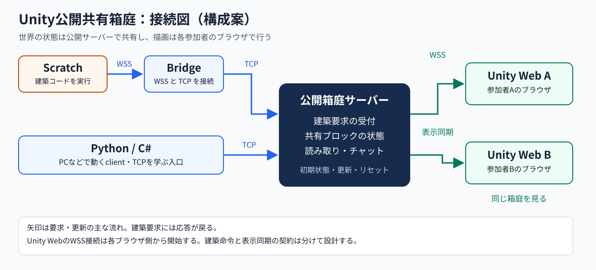
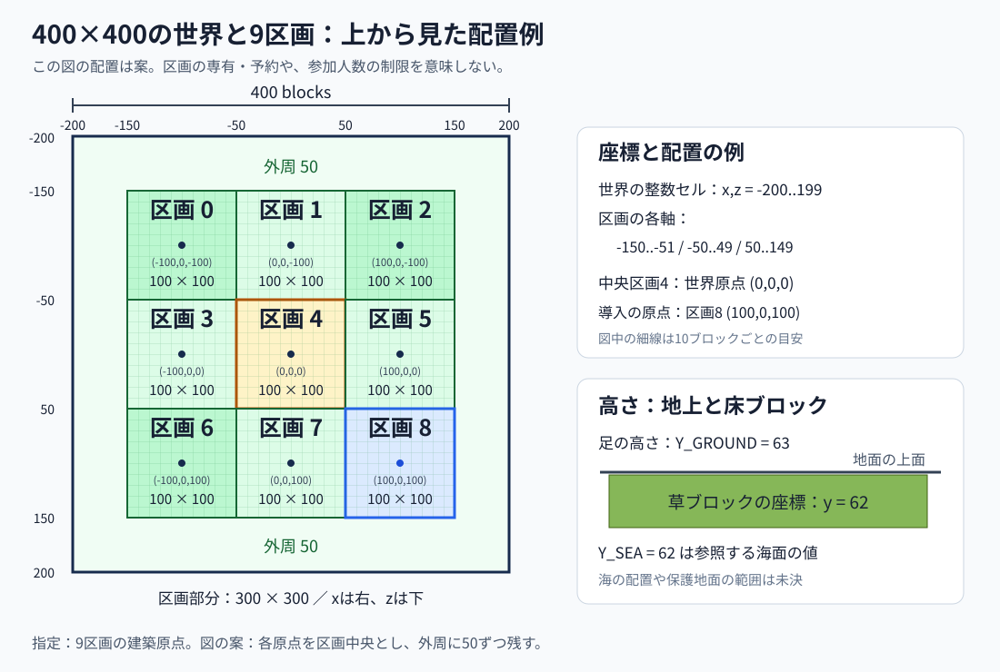
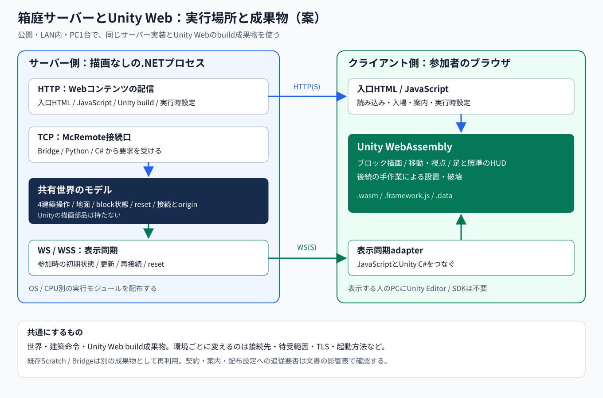

# Unity公開共有箱庭の設計メモ

更新日: 2026-10-23。公開共有箱庭の設計案です。未確定の項目には案または未決と記し、共通Protocolの契約はknowledgeを正本とします。

着手する範囲は[Unity内部の先行作業](unity-internal-preparation_ja.md)で整理します。この文書の接続・server・配布の構成は到達形の案です。先行するのは、共通ProtocolやClient Libraryに依存しないUnityの表示・操作・性能確認で、通信や共有の意味論はD/E/Fの成果とその後の進行へ接続します。

## 1. 入口と利用像

URLを開き、Python・Scratch・C#で建築し、複数人が同じ箱庭で結果を見られる入口を作ります。学習者にMinecraftの購入・導入やUnity Editorの使用を要求しません。

Unityは世界を表示し、歩く・見回す操作と座標表示を提供する側です。共有するブロックの状態は公開サーバーが管理します。一人のブラウザを閉じても、ほかの参加者が続けられる構成を目指します。

学習者が変更するのは、まず外部のコードやScratchのブロックです。Unityの制作そのものや複数Unityアプリの連携は発展の選択肢とします。Web版を、公開箱庭の初回導入を容易にする入口として検討します。

### 1.1 ミッションとビジョン

最上位のミッションは、人の創造性を引き出すことです。コーディングで学ぶ過程でも、その結果として生まれる作品でも、自分の発想を試し、表現できる場を目指します。観察・言語化・検証と技法の習得は、その探究を支えます。

Unity箱庭を、MinecraftとScratchを結ぶ探究への入り口と、それぞれの表現を広げる新しい柱として早く形にしたいと考えています。共通化の成果を連携へ使う方針に沿って、表示・操作・表現の体験を先に試します。

当面の進め方は、開発計画の大枠を保ち、共通基盤の整備と、通信に依存しないUnity内部の試作を並行する形です。両方向の成果と発見を持ち寄り、接続部分で合流します。

ブロック建築を入口に、3Dモデルへのスクリプティングや外部からのリモコン操作など、3D空間での表現へ広げることにも関心があります。これは将来の探究候補で、具体的な対応操作は小さな試作を通じて検討します。

## 2. 設計条件

| 項目 | 内容 |
| --- | --- |
| 世界の水平サイズ | 400×400ブロック |
| 区画 | 100×100の区画を9個。Minecraftの箱庭と同じ感覚で使う |
| 高度 | ブロックのyは0〜255など。初期候補は256層 |
| 海面の参照値 | `Y_SEA = 62` |
| 地上の参照値 | `Y_GROUND = 63` |
| 世界原点 | 中央区画の建築原点を`(0,0,0)`とする |
| 区画番号 | 上段左から`0..8`。中央は区画4 |
| Unityの導入用origin | 導入ガイドと初期サンプルで`(100,0,100)`を明示する（区画8） |
| 利用場所 | 頻繁にリセットするため、どの区画も自由に使える |
| 建築の基本操作 | `postToChat`、`setBlock`、`getBlock`、`setBlocks` |
| ブロックの見た目 | Minecraftのテクスチャを持ち込まず、Unityの金属・発光・透明などの表現へ置き換える |
| 座標表示 | 自分の足・下半身の位置と、照準先のブロックの位置 |
| 表示するstream | 計画中の、呼出元APIによって表示対象を選ぶ方式へ合わせる |
| 手作業での設置・破壊 | 実現可能。手で積む練習からコードへつなぐ。後続でよい |
| 地面 | 固定する案。APIからの変更にも同じ保護を適用することを提案 |

区画の辺と原点の位置関係、世界の外周、地面の具体的な保護範囲は未確定です。

## 3. 接続図



公開箱庭サーバーが共有する世界の状態を管理します。図の建築要求には応答が戻ります。表示同期のWSS接続は各ブラウザ側から開始し、その接続上でサーバーから更新を受け取ります。ブラウザでTCPの待受をする構成ではありません。

役割は次のように分けます。

| 部分 | 担当すること |
| --- | --- |
| Scratch・Python・C# | 建築の要求を送る。戻り値やエラーを受け取る |
| Bridge | 既存のWSSとTCPの通信境界をつなぐ。現行のroutingや設定に従う |
| 公開箱庭サーバー | 要求の解釈、範囲などの検査、共有ブロック状態の更新、getへの応答、リセット |
| 表示同期 | 参加直後の箱庭の状態と、その後の変更を各画面へ渡す |
| Unity Web | 受け取った状態を描画し、自分の位置・照準を表示する |

建築の入口では現行McRemote Protocolへの適合を検討します。表示同期は別の契約として設計します。既存Protocolはserver pushを採用していないため、表示更新を既存clientへ暗黙に追加しません。Bridgeの既存実装だけで、共有状態や表示同期まで完成するわけではありません。

TCP経路は、サーバー／クライアントモデルを学ぶ入口として残します。ブラウザ内でPythonまで実行する場合は、PC上のPython clientとは別に、実行環境と通信adapterの設計が必要です。最初から全言語をブラウザ内実行へ揃えることは条件にしません。

## 4. 世界と9区画

中央区画4の建築原点を世界原点`(0,0,0)`にします。区画番号は上段左から`0..8`です。

| 区画 | 建築原点 `(x,y,z)` |
| --- | --- |
| 0 | `(-100,0,-100)` |
| 1 | `(0,0,-100)` |
| 2 | `(100,0,-100)` |
| 3 | `(-100,0,0)` |
| 4（中央） | `(0,0,0)` |
| 5 | `(100,0,0)` |
| 6 | `(-100,0,100)` |
| 7 | `(0,0,100)` |
| 8 | `(100,0,100)` |

100×100を3×3に並べると、区画部分は300×300です。図の配置案では、各原点を100×100区画の中央とみなし、x・zの世界の整数セルを`-200..199`、区画の範囲を各軸`-150..-51`、`-50..49`、`50..149`とします。外周は各50、区画間の通路幅は0です。区画の端と外周の定義は未確定です。



区画番号は位置の説明用で、利用者の専有権や予約番号ではありません。9人までという人数制限も意味しません。世界の外へ置いた場合の結果、外周の歩行制限、通路の形、出現位置、同時参加者数は未決です。

区画原点はbuild originを選ぶ際の足場です。どのstreamがどの原点を使うかはhelloや既存のbuild contextの指定で決め、HUDは選択したstreamのserver正準originを使います。原点はどれもy=0で、地上の63を暗黙に足しません。

### Unityの導入で使うorigin

Unity向けの導入ガイドと初期サンプルでは、build originとして`(100,0,100)`を明示します。世界原点は中央区画4の`(0,0,0)`のままで、導入の建築場所は区画8です。

例えば、相対座標`(0,63,0)`へ置く操作は、世界の絶対座標`(100,63,100)`へ置くことになります。建築原点の指定であり、閲覧者の出現位置やカメラ位置は別に決めます。

出力先や教材に応じて別の原点を明示できる構成にします。これは共通Protocolの未指定時の初期値とは別の扱いで、Unity専用の既定値をProtocolへ埋め込む方式にはしません。

### 高さと足元の1ブロック差

SSOTの`y_ground`は「地面に立つ人の下半身の標高」です。`y_sea`は最上段の水ブロックの標高です。

```text
y = 63   feet position / top surface of the ground
y = 62   top ground block, or top water block at sea level
```

草の最上段ブロックはy=62、その上に立った足はy=63とします。照準が指す床ブロックのy=62と、足のy=63を分けて表示します。

これらは世界定数で、helloの`world_constants`を通じてclientへ渡す計画です。現行実装は`y_sea=62`までで、`y_ground=63`などの追加定数は未実装です。ソース側の`Y_SEA`・`Y_GROUND`という名前と、wire上の`world_constants`内の名前を分けて扱います。海や水流を実際に作るかは未決です。

世界定数の拡張とHUD機能は、安定版の後、なるべく早い実装を予定しています。追加fieldのexact schemaやHUD APIは、その共通作業で定める契約へ追従します。Unity専用の別名・別契約を先に固定しません。

APIの座標は、現行契約の「絶対座標=streamのserver正準origin＋入力座標」に合わせます。海面の62や地上の63を、暗黙のYオフセットにしません。world内のブロックのy範囲と、足やカメラが移動できる高さの範囲も分けて決めます。

## 5. 初期の建築操作

次の4操作を初期の建築機能にします。利用側の名前は代表表記で、厳密な公開method名は各Client Libraryに従います。

| 利用側の操作 | 現行wire method | 箱庭での役割 |
| --- | --- | --- |
| `postToChat` | `chat.post` | 共有箱庭のチャットへ文字を表示する |
| `setBlock` | `world.setBlock` | 一つの座標へブロックを置く。空気を置く操作で消す |
| `getBlock` | `world.getBlock` | サーバーが管理する、その座標のブロックを読む |
| `setBlocks` | `world.setBlocks` | 両端を含む直方体を指定したブロックで埋める |

`getBlock`は各ブラウザの描画状態ではなく、共有サーバーの状態を読みます。ほかの人が手作業で置いたものも、同じ状態から読めるようにします。

ブロック値は、現行の`block_id`と`state`を持つ構造へ合わせます。金などのstateを持たないブロックでも`state`は空objectとして存在します。草やTNTなどのstateを持つブロックは、対応するpropertyと既定値を契約に沿って決め、すべてを無条件に空objectへ潰しません。

4操作だけで接続基盤全体が完成するわけではありません。既存clientが必要とするhello、認証、build context、catalog等への対応範囲を確認する必要があります。Minecraftのplayerへ束縛される現行の認証を、このMinecraft不要の箱庭へどう適用するかは未決です。

## 6. Unityで用意するブロック

Minecraftのテクスチャを持ち込まず、Unityの材質で表現します。目的は、隣接ブロックの境界がはっきりして、縦横の個数を数えやすいことです。論理的なブロックIDと、画面上の見た目を分けて扱います。

| ブロック | 論理IDの候補 | 表現の案 |
| --- | --- | --- |
| 金ブロック | `minecraft:gold_block` | 金色の金属。各立方体の辺・面の区切りを残す |
| 鉄ブロック | `minecraft:iron_block` | 銀色の金属。金と区別できる色・明るさ |
| シーランタン | `minecraft:sea_lantern` | 明るい発光材質。辺の形を失わない |
| ガラスブロック | `minecraft:glass` | 透明感と、数えるための輪郭・枠 |
| ダイヤモンドブロック | `minecraft:diamond_block` | 水色系の、ほかの金属と区別しやすい材質 |
| 草ブロック | `minecraft:grass_block` | 緑の上面と地面と分かる側面。地面にも使用 |
| 空気 | `minecraft:air` | 可視のブロックなし。削除操作にも必要 |
| TNT（おまけ） | `minecraft:tnt` | 独自の色や模様で分かる立方体。爆発の実装は後続の候補 |

IDとstateの対応は、実装時にcatalogと共有fixtureで確かめます。見た目を置き換えることを、Minecraftの全block state・物理・発光・爆発まで再現するという意味にしません。

## 7. 足の座標、照準の座標、表示対象stream

初期の表示対象は次の二つです。両方を見られるようにし、二行同時表示か切替式かはUI設計で確定します。Minecraft側の計画は足と照準を切り替える方式です。

| 対象 | 表示する座標 |
| --- | --- |
| 自分の足・下半身 | その点を含むブロックの整数座標。各軸をfloorする。カメラや体の中心の座標、立っている床の座標とは区別 |
| 照準 | 視線が当たったブロックそのものの整数座標。隣に置く予定のブロックの座標とは区別。当たらない場合は`—` |

絶対座標と、選択streamのserver正準originに対する相対座標を示します。例えばoriginが`(100,0,100)`で、足の絶対座標が`(120,63,130)`なら、相対座標は`(20,63,30)`です。HUDの整数表示と、APIで扱う連続座標を同じ型へ潰しません。

計画中のAPIによるstream選択は、次の意味へ合わせます。

- 接続ごとにbuild originがあるため、HUDがどの接続の原点を基準にするかを選ぶ。
- HUDのAPIを呼んだ接続が表示対象になる。ほかの接続の通常の建築操作で勝手に切り替えない。
- WireScope IDは表示中の接続を人間が照合するために添える。IDを入力して他人の接続を選ぶ仕組みにはしない。
- 有効な接続がない場合などは相対座標を`—`にし、絶対座標は表示を続ける。
- Minecraftで計画されている初回・切断時・再接続時の選択規則を参照し、Unityの閲覧者との対応を確定する。

これは「建築コマンドの送信先を別streamへ振り替える」という意味ではありません。APIの厳密な名前、引数、権限、エラーは未批准です。Unityの自分の視点・閲覧セッションと、外部Python・Scratch・C#の接続を結び付ける方法も、Minecraft不要の入場方法と合わせて設計する必要があります。

照準はRaycastなどで実現できます。距離や透明ブロックを通すか、表示する対象の形、操作デバイスは今後決めます。Minecraft側のHUD計画には短距離の照準という方針があります。

## 8. 頻繁なリセットと、自由に使える共有空間

区画は場所を見分ける目安にします。恒久的な割当や、利用者ごとの専有区画を初期の前提にしません。誰でも使える同じ世界で、ほかの人の建築結果も見られるようにします。

リセットでは初期地形と必要な初期状態へ戻します。周期、事前表示、チャット履歴、視点・HUD・streamの扱いは未決です。リセット前の遅延した更新や建築のキューがリセット後の世界へ混ざらないようにする必要がありますが、その具体的な同期契約や既存接続の扱いはここでは固定しません。

作品の長期保存は前提にしません。Scratch projectやPython・C#のソースを利用者が残し、再実行して作り直せる入口を大切にします。コードの保存と、世界データの保存は別に扱います。

## 9. 手作業で置く・壊す機能（後続）

Unityで実現できます。照準先のブロックを壊し、照準が当たった面の隣へ選択したブロックを置く操作です。マウス、キーボード、タッチの操作方法は後で決めます。

```text
manual action
    -> block edit request
    -> shared server validation and update
    -> all Unity views

Python / Scratch / C#
    -> building request
    -> same shared server validation and update
    -> all Unity views
```

見ているブラウザだけを書き換えて終わらせず、コードによる建築と同じ共有状態へ反映します。手で積んだものを`getBlock`で調べ、同じ形をコードで作る体験へつなげます。

地面を固定するなら、草の最上段を含む初期地形を保護し、その上を作業空間にする案が分かりやすいです。前述の高さ案なら、保護候補はy=0〜62、編集候補はy=63〜255です。これは提案であり、保護する層と場所は要確定です。

この保護は、手作業とAPIの両方へサーバー側で適用します。地面をまたぐ`setBlocks`をどう失敗させるかも既存契約と整合させ、見た目だけ地面を固定する実装にはしません。具体的なエラーや範囲処理はknowledgeで確定してから実装します。

手で数個積む、足と照準の座標を読む、コードで同じ形を積む、ループで繰り返す、という学習の入口を作れます。この機能を最初の公開共有箱庭の試作に必須とはしません。

## 10. 表示規模と段階

400×400×256は、論理上40,960,000セルです。これをすべて個別のGameObjectとして配置する規模とは考えません。固定の地面と変更されたブロックを分け、必要な範囲の描画・状態転送を行う方式を検討します。chunkやmeshの具体的な方式は、試作で負荷を見て選びます。

発光ブロックを全て個別の実時間ライトにする必要はありません。透明なブロックも、輪郭の読みやすさと端末負荷を合わせて確認します。初回ロードと、Scratchを同じ画面で動かした場合を含め、学習者のPC・タブレットで評価します。Webへ置くだけで描画が軽くなるという主張はしません。

| 着手区分 | 対象 |
| --- | --- |
| Unity内部で先行 | 材質、地面と9区画の表示、移動・照準、ローカルな座標表示、C#による配置デモ、描画性能、Unity Web build |
| 共通化の入力に接続する部分 | 接続・認証、server対応範囲、世界定数、HUDのAPIとstream選択、表示同期、保護地面と大きい範囲操作 |
| 連携段階の最小検証 | 共通のcontract/fixtureを使い、2ブラウザで同じ世界の建築結果と読み取りが一致する |
| 公開箱庭の到達形 | 400×400、9区画、学習用ブロック、4建築操作、足・照準の表示、共有状態とリセット |
| 後続 | 正式な手作業での設置・破壊、手作業とコードを行き来する教材、TNTの追加挙動など |

一般用途C# clientの実装順はknowledgeの多言語ロードマップに従います。G/H/Iの並行開始を含む進行の具体化と、Unity内部の準備を分けます。共有world serverの実装ownerとrepo配置は未決です。

## 11. 実装形態の案：箱庭サーバーとUnity Web

機能の実装は「箱庭サーバー」と「Unity Web」に集め、既存のScratch・Bridge・Python/C# clientを使う構成を第一案にします。ただし、既存ProtocolのMinecraft依存と、配布・設定の変更は別に評価します。二つのプログラムだけを書けば、周辺の変更が必ずゼロになるという意味ではありません。

この実装形態は、共通化の成果を使って連携する段階の案です。今のUnity内部の先行作業では、TCP/WS受付、Protocol codec、認証、共有world serverや同期形式を作りません。



### 11.1 箱庭サーバーは描画なしの.NETプロセスを第一案にする

初期の4建築操作には、Unityの描画エンジンは不要です。通常のC#/.NETアプリとしてTCPの受付、世界の状態、表示同期用WebSocket、WebコンテンツのHTTP配信を一つのhostへまとめる案を勧めます。公開用とLAN用で世界の実装を分けず、同じhostの起動設定を変えます。

| サーバー内の部分 | 仕事 |
| --- | --- |
| McRemote接続口 | 改行区切りJSON-RPCのTCP受付。Bridgeからもnative clientからも同じ意味で扱う |
| 接続・build context | 認証、stream、dimension/origin、許可範囲、世界定数、計画中のHUD APIとの対応 |
| 世界のモデル | 固定地形、変更されたブロック、4操作、地面保護、リセット。描画部品に依存しない |
| 表示同期 | 参加時の初期状態、変更の順序、取り直し、リセットを各ブラウザへ渡す |
| Web配信 | 入口HTML・JavaScript・Unity build成果物・実行時設定・案内を配信する |
| 起動と終了 | 待受先・port・リセット設定などを読み、診断できる状態を出し、終了処理をする |

最初は一つのプロセスにまとめ、TCPとHTTP/WebSocketの受付口を論理的に分けます。どのURL pathやport番号にするかは未決です。公開環境では手前のWebサーバーなどでHTTPS/WSSを終端し、LANやPC1台では同梱hostを使う構成にできます。

世界のモデルに置くのはブロックの状態と意味です。金属の材質、光、カメラ、照準の見た目などはUnity Webへ置きます。サーバーがUnityの各フレームを描画・映像配信する構成にはしません。

Unity Dedicated Serverで描画なしの実行アプリを作る方法もあります。将来Unityの物理などをサーバーでも共用する要求が出たら比較します。現段階では、4操作のためにUnity engineをサーバーの実行条件へ足す必要性が低いため、通常の.NET hostを第一案とします。これは採用済みの実装技術ではありません。

### 11.2 ブラウザで動くもの

| 部分 | 実行場所・形式 | 仕事 |
| --- | --- | --- |
| 入口ページ | ブラウザのHTML/JavaScript | 箱庭を開く、入場・接続、案内、再接続、Scratchを開く導線 |
| Unity Web本体 | ブラウザ内のWebAssemblyとUnityのJavaScript | ブロック描画、移動・視点、足/照準座標の表示、後続の手作業 |
| 表示同期adapter | ブラウザのJavaScriptとUnity側C#の連携 | サーバーへWS/WSS接続し、初期状態と変更をUnityへ渡す |
| Scratch | 既存のScratch browser application | 既存のリモコン拡張で建築要求を送る。Unity表示とは別のアプリとして扱う |

Unity WebのC#はbuild時にブラウザ用の実行モジュールへ変換されます。配布されたページを見る人がUnity Editorや.NET SDKをインストールする構成ではありません。ブラウザで任意のC#ソースを書いてその場で実行する機能は、この構成には含めません。

ScratchとUnityを同じ画面へ並べる場合も、Scratch VMへUnityの世界を埋め込む改造を前提にしません。まず独立した画面で成立させ、必要なら入口ページで並べる方法を検討します。iframeを使う場合は、既存Scratchの埋め込み可否や配信header、ファイル保存などを実際の成果物で確認します。単にiframeのURLを書けば全機能が動くとは決めつけません。

### 11.3 Webコンテンツと配布する実行モジュール

| 配布物 | 内容・扱い |
| --- | --- |
| 箱庭サーバーの実行モジュール | OS/CPU別の.NET実行アプリ。LAN向けはruntime同梱方式を候補にし、利用者にSDKやUnity Editorを要求しない |
| 入口のWebコンテンツ | HTML、JavaScript、style、案内。配信先は起動設定で決める |
| Unity build成果物 | `.loader.js`、`.framework.js`、`.wasm`、`.data`など。ひとまとまりの版として配布する |
| Unity用の実行時設定 | 接続先、表示同期URL、箱庭の識別など。静的buildへ公開環境のhostを焼き込まない。exact schemaは未決 |
| ScratchとBridge | 既存releaseの成果物を再利用する。Unityの世界の状態をBridgeへ持たせない |
| 入門用の作品・コード | Unityの導入ではorigin`(100,0,100)`を明示したScratch/Python/C#の見本。利用者が編集して保存する作品は配布物の版から分ける |

世界定数・区画・originは箱庭サーバーの同じ設定/モデルから供給し、Webページ、Scratchの接続設定、Bridgeの宛先を別々の手入力で漂流させない方針にします。ただしScratchへ渡す設定は既存のruntime config schemaへ変換し、Unity用のfieldを勝手に追加しません。

Unity Webを`file://`で直接開く導線にはしません。PC1台でもHTTPサービスから読み込みます。Web配信ではWASMのMIME typeと圧縮headerをUnityのbuild設定へ合わせ、異なる版のloader・WASM・dataを混ぜないようにします。

一般用途C# Client Libraryは引き続き送り手のlibraryです。箱庭サーバーの責務をこのlibraryへ追加せず、libraryの`netstandard2.1`や根のnamespaceも変更しません。サーバー側の共通C#モデルとUnity Projectを同じ開発repoへ置く案はありますが、ownerと配置先はknowledgeで確定します。

## 12. 影響を二つの新componentへ限定できるか

答えは「主な機能実装は集中できるが、契約と配布まで含む影響ゼロは、まだ保証できない」です。

| 対象 | 限定する方針 | 必要な確認・変更候補 |
| --- | --- | --- |
| Minecraft/Paper/McRemote | Unity箱庭のための描画・同期・server機能を足さない | 共通の世界定数/HUDは、既に予定している安定版後の作業として扱う |
| 一般用途C# library・Python client | 既存Protocolの送り手として利用する | hello/auth、catalog、metadata、未対応methodの扱い、原点設定を照合する |
| Scratch VM/リモコン拡張 | 建築要求とstreamの意味を変えない | Minecraft前提のペアリング案内、catalogや接続情報の表示に最小の追従が要る可能性がある |
| Bridge本体 | WSS/WSとTCPをつなぐ既存の機能を使う | Unity箱庭への宛先とallowlistなど、正規の設定を追加する |
| Scratch runtime config | 既存schemaのtargetとして箱庭を指定する | 接続先・表示名・案内などの設定。未知fieldを足さない |
| 公開の配布・起動・監視 | 新componentの成果物と起動方法を登録する | Stack側のartifact、配信、routing、起動/終了/doctorなど。既存componentのソース改造とは別の影響 |
| Unity箱庭サーバー・Unity Web | 世界・同期・表示をここへ実装する | 新規実装の中心 |

### 12.1 二つだけで完結すると断言できない具体的な点

1. **helloのMinecraft metadata**。現行契約は`mc_version`・`supported_mc_versions`を要求し、catalogの識別にもMinecraft版が関係します。Unity箱庭が実在しないMinecraft版を名乗って互換を装う方法は採りません。非Minecraftの出力先として正当に表す共通契約を確認・具体化します。
2. **入場・認証とplayer**。現在はMinecraftのplayerへtokenを束縛します。Unityではブラウザの参加者と建築streamを対応させる必要があります。既存の`auth.pairBegin`/`auth.pairPoll`を活用し、Unity Web側に承認の入口を置く案はありますが、本人性・permission・解除などの意味を確定してから使います。通常の公開箱庭を認証の一時bypassで成立させません。
3. **案内のMinecraft依存**。現行Pythonの案内はMinecraft内でのペアリングを求め、Scratchも`/mcremote pair ...`を表示します。通信methodを再利用できても、初めての人向けの自然な案内が新componentだけで完結するかは別に検証します。
4. **建築4操作以外の基盤**。既存clientはcatalogやbuild contextを使います。全methodを実装したふりはせず、対応範囲と接続時に必須の部分を共有fixtureで検証します。HUDと追加の世界定数は、安定版後の共通契約へ追従します。

現行Pythonはhelloの`world_constants`全体を保持し、Scratchにも保持する処理があります。追加定数の値の公開・補完・表示は、安定版後の共通作業で確認します。

このため、「新しい世界の実装はUnity側の二つへ集める」と「既存clientには一行も変更が要らない」を分けます。後者を達成できるかは、上の接続契約と案内を確認した結果で決めます。

## 13. 公開・LAN内・PC1台を同じ実装で動かす

公開版とローカル版を別の世界としてforkせず、同じ箱庭サーバーとUnity Web成果物を使います。変えるのは配置、待受範囲、接続先、TLS、起動方法、リセット間隔などです。Scratchの学習内容と作品は公開/LANで共通にする既存方針へ合わせます。

| 形 | 箱庭サーバーとUnity Webの配信 | Scratch/Bridge | browserの経路 |
| --- | --- | --- | --- |
| 公開箱庭 | 公開host。HTTPS/WSSの入口を用意する | 既存の公開Scratch/Bridgeにtargetを設定する案 | UnityはHTTPS/WSS、ScratchはWSS→Bridge→TCP |
| LAN内の共有箱庭（既存成果物を優先） | LAN内の担当PCで同じhostを実行し、Unity Webを配信 | Scratchを使う各PCで既存LANパッケージを起動。Bridgeから担当PCへTCP | Scratchは各PCのHTTP loopback/WS loopback。Unity表示はLANの配信へ接続 |
| PC1台 | 箱庭hostをloopbackで起動してUnity Webを配信 | 同じPCで既存Scratch LANパッケージを起動 | ローカルHTTP/WSとTCP。Web上の公開サービスへの接続を必須にしない |

LAN内のUnity Web用ページと表示同期は同じ配信元にまとめ、HTTP/WS簡易経路を作る場合は対象browserで確認します。Unity自身の表示同期がLANのWSへ対応できることと、既存ScratchのWS接続guardを変えてよいことは別です。

### 13.1 Scratch LANパッケージと揃えること

- 「LAN内」はPC1台の場合も含む。家庭・教室へ同じ体験を持ち込む配布形態とする。
- 利用者の入口は、OS用ZIPの取得・展開・起動・設定・作品を開く、の流れへ揃える。Unity Editor、Paper、Java、.NET SDKを学習者の前提にしない。
- Scratchの既存成果物を使う場合は、その配置・起動・終了・更新の契約に従う。既存のZIPへ黙ってファイルを上書きする形を避け、Unity箱庭用の配布物またはlauncherから組み合わせる。
- 起動設定の例は「箱庭をこのPCで動かす」「LAN内の別のPCを使う」。利用者が常にIP、port、Bridgeのallowlistを別々に編集する導線にはしない。
- 学習者のScratch projectとPython/C#ソースは、配布物の版フォルダーや頻繁にresetする世界から分離する。
- オフライン完結を名乗る版は、UnityのWASM/data、Scratch、Bridge、runtime、フォント、必要なsampleを同梱し、CDNや公開箱庭への依存が残っていないことを検証する。

Scratchの既存ブラウザ保存は、Webの配信元origin（scheme・host・port）に依存します。既存LANパッケージのScratch用の配信元を維持し、Unityのページを加えるために作品が消えたように見える移行を作らない方針とします。

### 13.2 タブレットだけでLAN内の共有箱庭を使う場合

PC向けのScratch LANパッケージをiPad/Androidのブラウザ上で起動できるわけではありません。各端末のloopbackにScratch/Bridgeを置く上の経路は、PC向けです。

タブレットだけでScratchとUnityを開く場合は、LAN内の担当PCから両方を配信し、Bridgeもそこへ置く構成を別に検証します。現行のScratch runtime contractは平文WSをHTTP loopback page/loopback Bridgeの組に限っており、非loopbackのLAN簡易modeは未実装と記録されています。そのため次のいずれかが必要になります。

- 既存Scratchを変えず、タブレットが信頼するHTTPS/WSSの配信・接続環境を用意する。
- LAN簡易modeを共通contractとして追加し、Scratchのguard・設定・案内まで実装・検証する。この選択では影響をUnityの二つだけに限定できない。

ブラウザ一般がHTTP/WSを扱えることだけを根拠に、既存ScratchがLANの平文WSへそのまま接続できるとは書きません。公開版のHTTPS/WSSを使う入口と、完全に閉じたLANでの運用も区別します。

### 13.3 ローカル配布物の構成例

次は論理的な構成例で、package名やfile名の決定ではありません。

```text
Unity-sandbox-LAN/<version>/
  start-...                    OSに合う起動・終了の入口
  settings.json                接続・待受などの保存設定
  はじめに.html                 起動前にも読める案内
  data/
    server/                    runtime同梱の箱庭host
    web/
      index.html               入口ページ
      ...js                    表示同期などのJavaScript
      Build/
        ...loader.js
        ...framework.js
        ...wasm
        ...data
    scratch-lan/               組み合わせる既存成果物（同梱する場合）
```

launcherは必要なプロセスを起動し、用意ができたローカルURLを開く構成を考えます。終了時にどのプロセスを止めるか、LANの他の人が使う箱庭を誰が止めるかを分けます。OS/CPU別runtime、ZIPのidentity、更新、失敗時のログの場所は実装時の配布contractとして定めます。

## 14. 実装前に決めること

- 9原点に対する各区画の辺、400×400の外周、通路、出現位置。
- y=0〜255を採用するか、固定する地形の範囲。
- Minecraftのplayerを前提にしない入場・認証と、閲覧者と建築streamの対応。
- HUDのAPIのexact contract、両座標の表示方法、照準の対象と距離。
- 支持するblock state、未対応のブロックや範囲外の扱い、`setBlocks`の有限な処理量。
- 表示同期の初期状態・更新・再参加・リセットの整合。
- 対象ブラウザ・端末、最低限の性能、同時参加者数とリセット間隔。
- 非Minecraftのhello metadata・認証と既存clientへの追従範囲。世界定数/HUDの安定版後の契約との接続。
- .NET hostを採用するか、公開・LAN・PC1台の配布ownerと成果物、タブレットLANのTLSまたはScratch対応方針。
- 対象機能で利用するPhase D/E/Fの成果と、G/H/Iの着手範囲。Unity内の試作データや描画構造を共通契約の代わりにしない。

## 15. 根拠とknowledgeへの搬送

区画の辺や外周、地面保護の具体値、.NET hostなど、未確定の構成は設計案として扱います。

人の創造性を引き出すという最上位のミッションと、Unityを新しい柱として育て、3D空間の表現へも広げるビジョンは、human ownerから示されたものです。言語化を継続しており、knowledgeへの着地は未実施です。

実際に読んだknowledge commit: `c3381ba1542a463870ade7f03d67e9e5e2947acd`。

- [C# Client Libraryの境界](https://github.com/Naohiro2g/mc-remote-knowledge/blob/c3381ba1542a463870ade7f03d67e9e5e2947acd/18-csharp-client/README_ja.md)
- [多言語Client Libraryロードマップ](https://github.com/Naohiro2g/mc-remote-knowledge/blob/c3381ba1542a463870ade7f03d67e9e5e2947acd/10-protocol/polyglot-client-roadmap_ja.md)
- [既存の学習支援方針・創造性を支える制約](https://github.com/Naohiro2g/mc-remote-knowledge/blob/c3381ba1542a463870ade7f03d67e9e5e2947acd/20-%E6%95%99%E6%9D%90/ai-learning-design_ja.md)
- [wire形式・座標・block値](https://github.com/Naohiro2g/mc-remote-knowledge/blob/c3381ba1542a463870ade7f03d67e9e5e2947acd/10-protocol/wire-format-design_ja.md)
- [block値と状態](https://github.com/Naohiro2g/mc-remote-knowledge/blob/c3381ba1542a463870ade7f03d67e9e5e2947acd/10-protocol/block-value-design_ja.md)
- [世界定数の意味](https://github.com/Naohiro2g/mc-remote-knowledge/blob/c3381ba1542a463870ade7f03d67e9e5e2947acd/00-hub/world-constants-facts_ja.md)
- [計画中の座標HUD・stream選択（§11）](https://github.com/Naohiro2g/mc-remote-knowledge/blob/c3381ba1542a463870ade7f03d67e9e5e2947acd/11-plugin/platform-design_ja.md)
- [XYZ空間の建築教材](https://github.com/Naohiro2g/mc-remote-knowledge/blob/c3381ba1542a463870ade7f03d67e9e5e2947acd/20-%E6%95%99%E6%9D%90/xyz-space-learning-design_ja.md)
- [Scratch LANパッケージの構成と体験](https://github.com/Naohiro2g/mc-remote-knowledge/blob/c3381ba1542a463870ade7f03d67e9e5e2947acd/13-scratch-client/scratch-lan-package-design_ja.md)
- [deploymentの設定境界・LANとTLS（§6.1）](https://github.com/Naohiro2g/mc-remote-knowledge/blob/c3381ba1542a463870ade7f03d67e9e5e2947acd/00-hub/deployment-interface-design_ja.md)
- [UnityのRaycastHit](https://docs.unity.com/en-us/engine/6000.3/script-reference/unityengine/raycasthit)
- [UnityのCharacterController](https://docs.unity.com/en-us/engine/7000.0/script-reference/unityengine/charactercontroller)
- [Unity Web buildの実行モジュールとdata](https://docs.unity3d.com/6000.3/Documentation/Manual/webgl-building.html)
- [Unity WebのHTTP配信・圧縮header](https://docs.unity3d.com/6000.3/Documentation/Manual/webgl-deploying.html)
- [.NETのruntime同梱配布](https://learn.microsoft.com/en-us/dotnet/core/deploying/)
- [ASP.NET CoreのWebSocket](https://learn.microsoft.com/en-us/aspnet/core/fundamentals/websockets?view=aspnetcore-10.0)
- [Unity Dedicated Server](https://docs.unity.com/en-us/engine/6000.0/manual/platform-specific/dedicated-server/build)

既存clientのソースも、ユーザーの作業cloneを使わずGitHub APIで固定commitから読みました。これらは接続試験の合格や、release compatibility setの指定を意味しません。

- Scratch: `develop@bee41dc9629ee3225c19ef1d6be1299b6b4bf7d1`の[リモコン拡張](https://github.com/Naohiro2g/scratch-editor/blob/bee41dc9629ee3225c19ef1d6be1299b6b4bf7d1/packages/scratch-vm/src/extensions/scratch3_mcremote/index.js)。hello情報、world constants、catalog取得、pairing command、build originの指定を確認。
- Python: `main@c30105349ef26413e925699143396ea05bd3e380`の[client](https://github.com/Naohiro2g/minecraft-remote-api/blob/c30105349ef26413e925699143396ea05bd3e380/mc_remote/minecraft.py)と[認証](https://github.com/Naohiro2g/minecraft-remote-api/blob/c30105349ef26413e925699143396ea05bd3e380/mc_remote/auth.py)。helloのworld constants保持、初期origin、Minecraft内のペアリング案内を確認。

横断方針の搬送先候補はknowledgeの`18-csharp-client`、hubのfor Unityのpark、教材スポークです。このローカル文書は未搬送の検討材料であり、既存contractの変更元にはしません。operator-localの捕捉と搬送票はrootの`NOTES_ja.md`で管理します。
