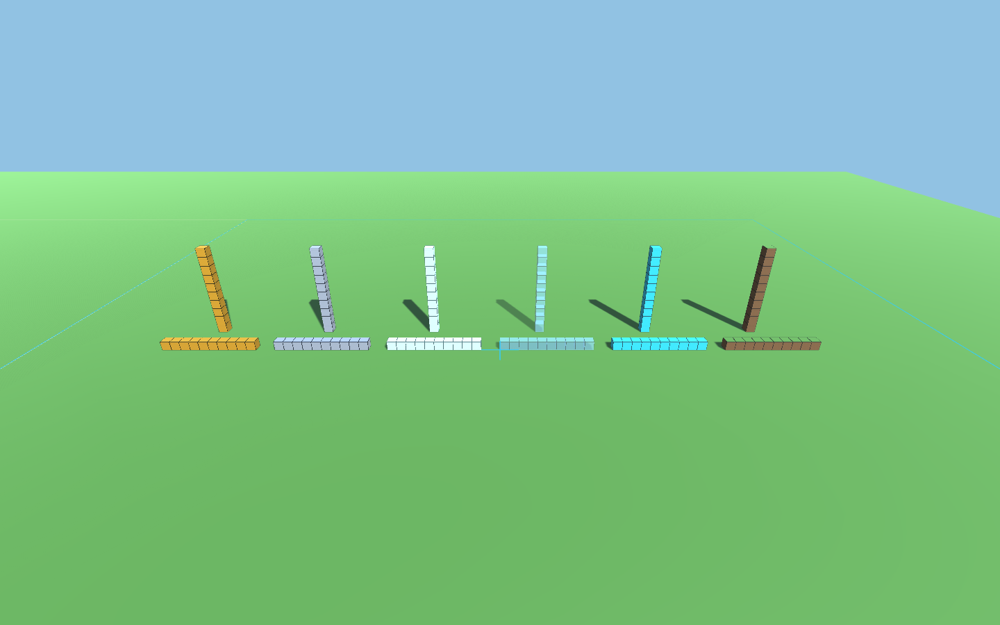

# Unityのローカル建築デモ

通信を使わずに、ブロックの見分けやすさ・数えやすさと、歩行・照準・座標表示を試すための試作です。
このリポで育て、後でUnity用の作業場所へ移せるよう、ライブラリから独立したフォルダーに置いています。

この版はBRP（Built-in Render Pipeline、従来の描画方式）の比較用として残します。URP版は別のプロジェクトで用意し、同じ建築場面で見た目と負荷を比べる方針です。



左から金、鉄、シーランタン、ガラス、ダイヤモンド、草。Minecraftのテクスチャーは使用せず、Unityの材質とコードで生成した境界線を使っています。画像はUnityによる描画で、プレイ中の座標表示は含みません。

## 試す

Unity 6の**3D (Built-in Render Pipeline)**、従来の入力機能（Input Manager）を使います。現在の確認環境は`6000.6.7f1`です。コンパイル・座標の検証・Play Modeの自動検証が通り、BRP版の試用も行っています。確認した内容は[観察メモ](observations_ja.md)を参照してください。URPなど別の描画方式への対応は後続で比べます。

### Unity Editorで準備する

1. Unity Hubで、3D (Built-in Render Pipeline)の空のプロジェクトを作ります。
2. このフォルダーの`Assets/LocalSandboxDemo`と隣の`LocalSandboxDemo.meta`を、作ったプロジェクトの`Assets`へコピーします。
3. Unity Editorで`Tools > Local Sandbox > Create Demo Scene`を選び、Playボタンを押します。

入力が効かない場合は、`Edit > Project Settings > Player > Other Settings > Active Input Handling`を`Input Manager (Old)`または`Both`にし、求められたらEditorを再起動します。日本語が欠ける環境では、プロジェクトに日本語フォントを用意し、`Local Sandbox Demo`の`Hud Font`へ指定してください。

### Linux／macOSのターミナルで準備する

`prepare-project.sh`にUnity Editor本体のパスを渡すと、無視対象の`.local/UnityProject`に空のプロジェクトを作り、試作コードをコピーしてシーンを生成します。通常のUnityのライセンスと初回の環境準備が必要です。

```sh
bash experiments/unity-local-demo/prepare-project.sh /path/to/Unity/Editor/Unity
```

表示された場所をUnity Hubへ追加して開き、生成されたシーンでPlayを押してください。再実行すると試作コードを上書きコピーし、シーンは別名で追加します。**編集元はこのリポの`Assets/LocalSandboxDemo`です。** 生成されたプロジェクトの同名コードを直接編集した場合は、再実行前に変更を編集元へ戻してください。

## 操作と場面

| 操作 | 動き |
| --- | --- |
| 画面をクリック | マウスで見回す |
| Esc | マウスを解放する |
| WASD／矢印 | 歩く |
| R | 開始位置・向きへ戻る |
| 1 | 各材質の10個の列・10段の柱へ切り替える |
| 2 | 各材質の5×3の壁・4段の階段へ切り替える |

最初の場面は120個、壁と階段の場面は150個です。地面や区画のガイドはこの個数に含みません。
`Local Sandbox Demo`の`Column Height`をPlay前に変えると、柱の高さを変えて比べられます。

地面は400×400を一枚で表し、上面がy=63、照準が読む地面のセルがy=62です。区画0〜8の原点と外周を線で表示し、中央の区画4は金色、区画8は水色にしています。区画の番号そのものは地面に印字していません。

足と照準のセル座標を、世界座標と表示原点からの相対座標で表示します。表示原点の初期値は`(100, 0, 100)`で、Inspectorの`Display Origin`から変えられます。ブロックの配置は表示原点から独立しています。照準が当たらないときは`—`と表示します。

## 変えて比べる

- `DemoPalette.cs`：材質の色・反射・発光・ガラスの透明度・境界線。
- `LocalSandboxDemo.cs`の`Populate`：柱・壁・階段の配置。普通のUnity内部の処理です。
- `LocalSandboxWalker.cs`：歩く速さ・視点の高さ・見回す感度。

数を数えるだけでなく、「この高さを変えたい」「この材質で別の形を作りたい」と思えたところを残します。
最初の観察は[観察メモ](observations_ja.md)へ記録します。

## 開発時の検証

`Tools > Local Sandbox > Validate Demo`は、編集中のシーンから独立したプレビューシーンを作って検証し、終わったら閉じます。
負の位置の切り下げ、相対座標、区画原点、地面と6面への照準、同じセルの置換・除去、場面の切り替えを確認します。失敗した場合はConsoleへ例外、成功した場合は`LOCAL_SANDBOX_VALIDATION_PASS`を出します。

同じ検証をコマンドから呼ぶ場合は、次の形です。`UNITY_EDITOR`と`DEMO_PROJECT`は、それぞれ手元の実行ファイルと準備済みプロジェクトの絶対パスに置き換えてください。

```sh
"$UNITY_EDITOR" -batchmode -nographics -quit -projectPath "$DEMO_PROJECT" \
  -executeMethod Code2Create.UnitySandbox.LocalDemo.DemoEditor.Validate -logFile /tmp/local-sandbox-validation.log
```

Play Modeの初期化・重力・歩行・地面の当たり判定は、同じコマンドの`-executeMethod`を`Code2Create.UnitySandbox.LocalDemo.DemoPlaySmoke.Run`へ変え、`-quit`を外して検証できます。結果は`LOCAL_SANDBOX_PLAY_SMOKE_PASS`または`FAIL`で出力し、自動終了します。実行結果と確認が残っている点は[観察メモ](observations_ja.md)に記録します。

`DemoEditor.CapturePreview`は、`-nographics`を外して`-demoPreview /absolute/path.png`を渡すと、材質比較の画像を書き出します。画面を使える環境が必要です。

## 今回の範囲と次に確かめること

これは少数のGameObjectを使う描画の比較基準です。草の上面には薄い表示用の面を重ねています。実際の歩きやすさ、端末ごとの日本語表示、透明なブロックが重なったときの数えやすさは、触って調整します。反射の見え方も、照明や周囲の映り込みを含めて比較する余地があります。

Webへの書き出し・タッチ操作・性能比較、手作業による設置と破壊は後続です。ビルドへ進む際には、コードから探す`Standard`と`Sprites/Default`のshader（描画処理）が生成物に含まれることも確認します。

通信、認証、共有世界の同期、Minecraft RemoteのC# Client Libraryには依存しません。材質の分類やセルの保持は、この試作内のもので、正式なブロックIDや配信形式の決定ではありません。

根拠となる範囲は[Unity内部で先に進める作業](../../docs/unity-internal-preparation_ja.md)と、knowledgeの[C#の現在地](https://github.com/Naohiro2g/mc-remote-knowledge/blob/49b93b1fb2fddc928de956ca2ffa9a7b462e19c8/18-csharp-client/README_ja.md)を参照してください。

実装時に参照したUnity公式資料：[照準のRaycast](https://docs.unity3d.com/6000.0/Documentation/ScriptReference/Physics.Raycast.html)、[CharacterControllerの移動](https://docs.unity3d.com/6000.0/Documentation/ScriptReference/CharacterController.Move.html)、[透明材質の設定](https://docs.unity3d.com/6000.0/Documentation/Manual/StandardShaderMaterialParameterRenderingMode.html)、[Editorのコマンドライン](https://docs.unity3d.com/6000.0/Documentation/Manual/EditorCommandLineArguments.html)。
